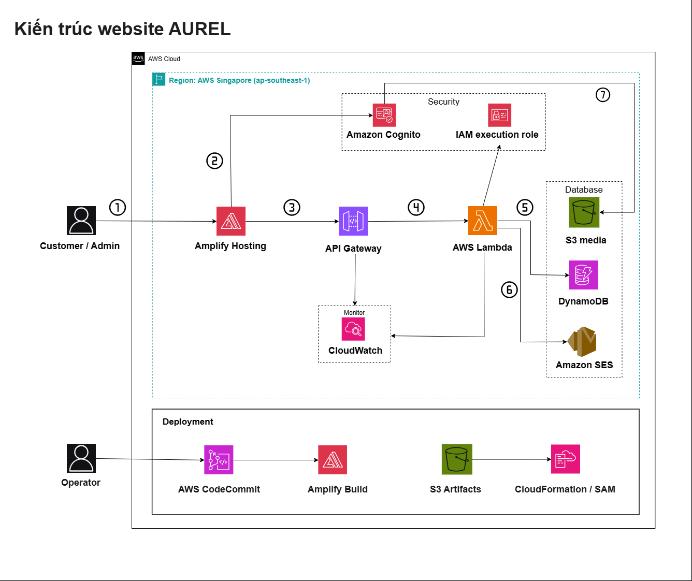

# Aurel Restaurant Website

## 1. Solution Overview

Aurel is a contemporary Vietnamese restaurant website designed to turn online visitors into restaurant guests. The current site presents the Aurel story, seasonal menu, dining space, contact information, and a clear route to make a reservation. Its visual direction focuses on thoughtful dining, Vietnamese flavours, and a warm, intimate atmosphere.

The proposed solution develops this website into a reliable digital guest journey. Visitors can discover the restaurant, browse the menu, view the gallery, find opening hours and location details, and submit a reservation request. Restaurant staff can review requests and manage reservation availability through a protected administration area.

## 2. Objectives and Scope

### Objectives

* Create a responsive, accessible website that reflects Aurel's contemporary Vietnamese dining identity.
* Help guests quickly find the menu, opening hours, location, contact details, and reservation experience.
* Provide a simple reservation-request workflow that reduces manual messages and phone calls.
* Use managed AWS services so that the website can be deployed, monitored, and scaled without maintaining servers.
* Give restaurant staff a secure way to review reservation requests and manage website content in later phases.

### Scope

**Included in phase 1**

* Public pages for Home, Menu, Gallery, Story, Contact, and Reservation.
* Mobile-friendly navigation and clear calls to action.
* A reservation form that records guest name, contact details, preferred date and time, party size, and special notes.
* Confirmation and notification workflow for submitted reservation requests.
* Basic staff administration and operational monitoring.

**Not included in phase 1**

* Online payment, food delivery, loyalty points, and a full table-layout management system.
* Integration with a third-party point-of-sale system.
* Real-time automatic confirmation without a staff review step.

## 3. Problems to Solve

| Problem | Effect on the guest or restaurant | Proposed response |
| --- | --- | --- |
| Restaurant information is scattered across social channels or messages. | Guests may not find the menu, opening hours, address, or reservation method quickly. | Maintain one clear, responsive website as the main source of information. |
| Reservation requests can be handled manually through calls and chat messages. | Staff may need to re-enter details, while guests may wait for a response. | Provide a structured reservation form and notify staff of each request. |
| A visual dining concept needs a strong online presentation. | Guests may not understand the Aurel experience before visiting. | Use the existing story, menu, gallery, and call-to-action pages to communicate the brand consistently. |
| A small restaurant team should not need to operate servers. | Infrastructure maintenance takes time away from guest service. | Use managed and serverless AWS services for hosting, APIs, storage, and monitoring. |

## 4. Preliminary Solution Architecture

The solution uses a serverless AWS architecture. The public website is deployed with AWS Amplify Hosting. A reservation request is sent through Amazon API Gateway to AWS Lambda, validated, and stored in Amazon DynamoDB. Staff receive a notification through Amazon Simple Email Service (SES). Amazon Cognito protects the administration area, while Amazon CloudWatch collects logs and alarms.

### AWS Services

* **AWS Amplify Hosting** — builds and hosts the public website with continuous deployment.
* **Amazon CloudFront** — delivers the website quickly through the Amplify hosting distribution.
* **Amazon API Gateway** — exposes a controlled HTTPS endpoint for reservation submissions.
* **AWS Lambda** — validates reservation data and coordinates backend actions without a server to manage.
* **Amazon DynamoDB** — stores reservation requests in a flexible, scalable database.
* **Amazon SES** — sends a notification to staff and, in a later phase, an acknowledgement to the guest.
* **Amazon Cognito** — controls access to the staff administration area.
* **Amazon CloudWatch** — records errors, request activity, and operational alarms.
* **AWS WAF** — optional protection for the public application as traffic grows.

## 5. Implementation Plan and Timeline

| Week | Milestone | Deliverables |
| --- | --- | --- |
| 1 | Discovery and content planning | Confirm restaurant information, page structure, menu data, brand tone, and reservation requirements. |
| 2 | User interface and public website | Complete responsive Home, Menu, Gallery, Story, and Contact pages; test navigation on mobile and desktop. |
| 3 | Reservation workflow | Build the reservation form, API endpoint, validation, DynamoDB storage, and staff-notification flow. |
| 4 | Security, testing, and launch | Protect staff access with Cognito, add CloudWatch monitoring, test reservation scenarios, and publish the production version. |
| Ongoing | Improvement and content maintenance | Update seasonal menu content, review reservation data, improve search visibility, and add features based on guest feedback. |

## 6. Cost Estimation

The following is a planning estimate for a low-traffic restaurant website. Actual charges depend on traffic, data retention, email volume, AWS Region, and any free-tier eligibility. Domain registration, tax, and optional third-party services are not included.

| Component | Estimated monthly cost | Notes |
| --- | ---: | --- |
| Amplify Hosting and delivery | USD 0–8 | Depends on build minutes, storage, and data transfer. |
| API Gateway and Lambda | USD 0–3 | Suitable for a low volume of reservation submissions. |
| DynamoDB | USD 0–3 | Low-volume reservation records and on-demand capacity. |
| SES and CloudWatch | USD 0–3 | Notification email and basic operational monitoring. |
| **Estimated total** | **USD 0–17 / month** | Validate the final configuration with AWS Pricing Calculator before launch. |

## 7. Risks and Mitigation

| Risk | Impact | Mitigation |
| --- | --- | --- |
| Incorrect or duplicate reservation requests | Guests may receive unclear booking status. | Validate the form, use a staff-review status, and show that a request is not confirmed until staff respond. |
| Exposure of personal contact details | Guest trust and privacy may be affected. | Store only necessary information, restrict staff access with Cognito, and follow a data-retention policy. |
| Spam or automated form submissions | Staff may receive unnecessary notifications. | Add server-side validation, rate limiting, and AWS WAF rules if traffic requires them. |
| Service or deployment errors | The website or reservation form may be unavailable. | Use CloudWatch alarms, deployment rollback, and regular reservation-flow testing. |
| Inaccurate menu or opening-hour information | Guests may have a poor experience before arriving. | Assign an owner for content updates and review seasonal content before publishing. |
| Costs increase with traffic or new features | Operating costs may exceed the initial estimate. | Set AWS Budgets alerts, review usage monthly, and use managed serverless services that scale gradually. |

## Expected Outcomes

The completed solution will give Aurel a cohesive online presence that reflects its dining experience and makes reservations easier to manage. Guests will have a clear path from discovering the restaurant to submitting a booking request, while staff will receive structured information in one place. The architecture can grow later to support automatic confirmations, table availability, online events, loyalty features, or point-of-sale integrations.
