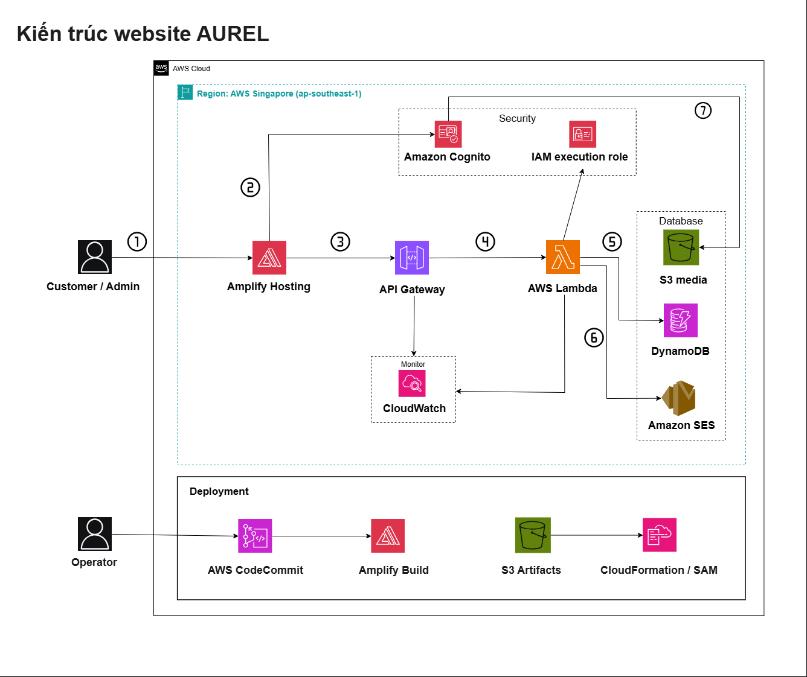

# Website nhà hàng Aurel

## 1. Tổng quan giải pháp

Aurel là website cho một nhà hàng ẩm thực Việt đương đại, giúp chuyển người truy cập trực tuyến thành thực khách. Website giới thiệu câu chuyện thương hiệu, thực đơn, không gian, thông tin liên hệ và đường dẫn đặt bàn rõ ràng.

Giải pháp đề xuất phát triển website thành một hành trình số hoàn chỉnh: khách khám phá nhà hàng, xem thực đơn, xem không gian và gửi yêu cầu đặt bàn; nhân viên xem các yêu cầu này trong khu vực quản trị được bảo vệ.

## 2. Mục tiêu và phạm vi

### Mục tiêu

* Xây dựng website thân thiện với thiết bị di động và thể hiện đúng phong cách ẩm thực Việt đương đại của Aurel.
* Giúp khách dễ tìm thực đơn, giờ mở cửa, địa chỉ, thông tin liên hệ và chức năng đặt bàn.
* Cung cấp quy trình yêu cầu đặt bàn có cấu trúc để giảm việc xử lý thủ công qua điện thoại hoặc tin nhắn.
* Sử dụng dịch vụ AWS managed để triển khai, giám sát và mở rộng mà không cần vận hành máy chủ.
* Cung cấp khu vực quản trị an toàn cho nhân viên xem yêu cầu đặt bàn.

### Phạm vi

**Giai đoạn 1 bao gồm**

* Các trang Trang chủ, Thực đơn, Không gian, Câu chuyện, Liên hệ và Đặt bàn.
* Điều hướng phù hợp trên điện thoại và lời kêu gọi hành động rõ ràng.
* Biểu mẫu lưu họ tên, thông tin liên hệ, ngày giờ mong muốn, số lượng khách và ghi chú.
* Thông báo cho nhân viên khi có yêu cầu đặt bàn mới.
* Khu vực quản trị cơ bản và giám sát vận hành.

**Chưa bao gồm trong giai đoạn 1**

* Thanh toán trực tuyến, giao đồ ăn, điểm thưởng và hệ thống quản lý sơ đồ bàn hoàn chỉnh.
* Tích hợp với hệ thống POS của bên thứ ba.
* Xác nhận đặt bàn tự động khi chưa có nhân viên kiểm tra.

## 3. Vấn đề cần giải quyết

| Vấn đề | Ảnh hưởng | Giải pháp đề xuất |
| --- | --- | --- |
| Thông tin nhà hàng nằm rải rác ở nhiều kênh. | Khách khó tìm thực đơn, giờ mở cửa, địa chỉ hoặc cách đặt bàn. | Duy trì website rõ ràng, phù hợp trên thiết bị di động làm nguồn thông tin chính. |
| Đặt bàn được xử lý thủ công qua cuộc gọi hoặc tin nhắn. | Nhân viên phải nhập lại thông tin, khách có thể chờ phản hồi lâu. | Dùng biểu mẫu có cấu trúc và thông báo cho nhân viên khi có yêu cầu mới. |
| Trải nghiệm ẩm thực cần được thể hiện tốt trên môi trường số. | Khách chưa hiểu rõ phong cách Aurel trước khi đến. | Dùng các trang Câu chuyện, Thực đơn, Không gian và lời kêu gọi hành động nhất quán. |
| Đội ngũ nhỏ không nên phải vận hành máy chủ. | Công việc hạ tầng làm giảm thời gian phục vụ khách. | Sử dụng dịch vụ AWS serverless và managed cho hosting, API, lưu trữ và giám sát. |

## 4. Kiến trúc giải pháp sơ bộ

Website công khai được triển khai qua AWS Amplify Hosting. Yêu cầu đặt bàn đi qua Amazon API Gateway đến AWS Lambda để kiểm tra dữ liệu và lưu vào Amazon DynamoDB. Amazon SES gửi thông báo đến nhân viên. Amazon Cognito bảo vệ khu vực quản trị, còn Amazon CloudWatch thu thập log và cảnh báo.

### Dịch vụ AWS sử dụng

* **AWS Amplify Hosting** — build và host website với continuous deployment.
* **Amazon CloudFront** — phân phối website nhanh qua Amplify.
* **Amazon API Gateway** — endpoint HTTPS cho yêu cầu đặt bàn.
* **AWS Lambda** — kiểm tra dữ liệu và xử lý backend không cần máy chủ.
* **Amazon DynamoDB** — lưu yêu cầu đặt bàn.
* **Amazon SES** — gửi thông báo đến nhân viên.
* **Amazon Cognito** — kiểm soát truy cập khu vực quản trị.
* **Amazon CloudWatch** — ghi log, theo dõi lỗi và tạo cảnh báo.
* **AWS WAF** — bảo vệ tùy chọn khi lưu lượng truy cập tăng.

## 5. Kế hoạch và timeline thực hiện

| Tuần | Mốc thực hiện | Kết quả bàn giao |
| --- | --- | --- |
| 1 | Khảo sát và lên kế hoạch nội dung | Xác nhận thông tin nhà hàng, cấu trúc trang, thực đơn, phong cách và yêu cầu đặt bàn. |
| 2 | Giao diện và website công khai | Hoàn thiện các trang công khai; kiểm tra trên điện thoại và máy tính. |
| 3 | Quy trình đặt bàn | Xây dựng biểu mẫu, API, kiểm tra dữ liệu, lưu DynamoDB và luồng thông báo. |
| 4 | Bảo mật, kiểm thử và phát hành | Bảo vệ quản trị bằng Cognito, thêm CloudWatch, kiểm tra đặt bàn và phát hành production. |
| Duy trì | Cải tiến và cập nhật nội dung | Cập nhật thực đơn theo mùa, xem dữ liệu đặt bàn và bổ sung tính năng từ phản hồi của khách. |

## 6. Dự toán ngân sách và chi phí

Đây là ước tính lập kế hoạch cho website nhà hàng có lưu lượng thấp. Chi phí thực tế phụ thuộc vào lưu lượng truy cập, thời gian lưu dữ liệu, số lượng email, AWS Region và ưu đãi Free Tier. Chi phí tên miền, thuế và dịch vụ bên thứ ba chưa được tính.

| Thành phần | Ước tính mỗi tháng | Ghi chú |
| --- | ---: | --- |
| Amplify Hosting và phân phối nội dung | 0–8 USD | Phụ thuộc thời gian build, lưu trữ và truyền dữ liệu. |
| API Gateway và Lambda | 0–3 USD | Phù hợp với lượng yêu cầu đặt bàn thấp. |
| DynamoDB | 0–3 USD | Lưu dữ liệu đặt bàn ở quy mô nhỏ. |
| SES và CloudWatch | 0–3 USD | Email thông báo và giám sát cơ bản. |
| **Tổng ước tính** | **0–17 USD/tháng** | Cần xác nhận bằng AWS Pricing Calculator trước khi triển khai. |

## 7. Rủi ro và phương án giảm thiểu

| Rủi ro | Ảnh hưởng | Phương án giảm thiểu |
| --- | --- | --- |
| Yêu cầu đặt bàn sai hoặc trùng lặp | Khách không rõ trạng thái đặt bàn. | Kiểm tra dữ liệu, có trạng thái chờ nhân viên duyệt và thông báo rõ yêu cầu chưa phải là xác nhận. |
| Lộ thông tin liên hệ của khách | Ảnh hưởng đến niềm tin và quyền riêng tư. | Chỉ lưu dữ liệu cần thiết, giới hạn quyền nhân viên bằng Cognito và có chính sách lưu trữ dữ liệu. |
| Spam hoặc gửi biểu mẫu tự động | Nhân viên nhận nhiều thông báo không cần thiết. | Kiểm tra dữ liệu phía server, giới hạn tần suất và thêm AWS WAF khi cần. |
| Lỗi dịch vụ hoặc triển khai | Website hoặc biểu mẫu có thể không hoạt động. | Dùng CloudWatch, rollback khi triển khai và kiểm tra luồng đặt bàn định kỳ. |
| Thông tin thực đơn hoặc giờ mở cửa sai | Khách có trải nghiệm không tốt trước khi đến. | Phân công người cập nhật nội dung và kiểm tra trước khi đăng. |
| Chi phí tăng theo lưu lượng hoặc tính năng | Vượt ngân sách ban đầu. | Đặt AWS Budgets alerts và xem lại mức dùng hằng tháng. |

## Kết quả kỳ vọng

Giải pháp giúp Aurel có hiện diện trực tuyến nhất quán với trải nghiệm dùng bữa và giúp quy trình đặt bàn dễ quản lý hơn. Khách có lộ trình rõ ràng từ khám phá nhà hàng đến gửi yêu cầu; nhân viên nhận thông tin có cấu trúc ở một nơi. Kiến trúc có thể mở rộng sau này cho xác nhận tự động, quản lý bàn, sự kiện trực tuyến, khách hàng thân thiết hoặc tích hợp POS.
