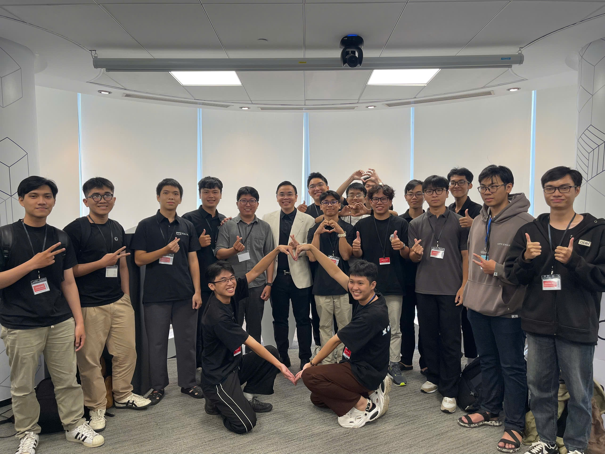

* **Date:** 26/09/2026
* **Location:** 26th Floor, Bitexco Financial Tower, 2 Hai Trieu Street, Sai Gon Ward, Ho Chi Minh City
* **Role:** Attendee

## Main Content

The event introduced the AWS Cloud learning journey and the importance of building a foundation in cloud concepts before working with services in depth. I followed discussions about the AWS ecosystem, core service groups, and the value of learning through guided hands-on exercises.

## Knowledge Gained

* Understood how AWS learning paths can be structured from cloud fundamentals to practical service labs.
* Reinforced the role of core areas such as identity, networking, compute, storage, databases, and monitoring.
* Learning how to face the upcoming job market.

## Personal Reflection

This event helped me understand the reality of the current job market requirement, fudemental of the cloud technology, and preperation for upcoming future.

## Attendance Evidence

