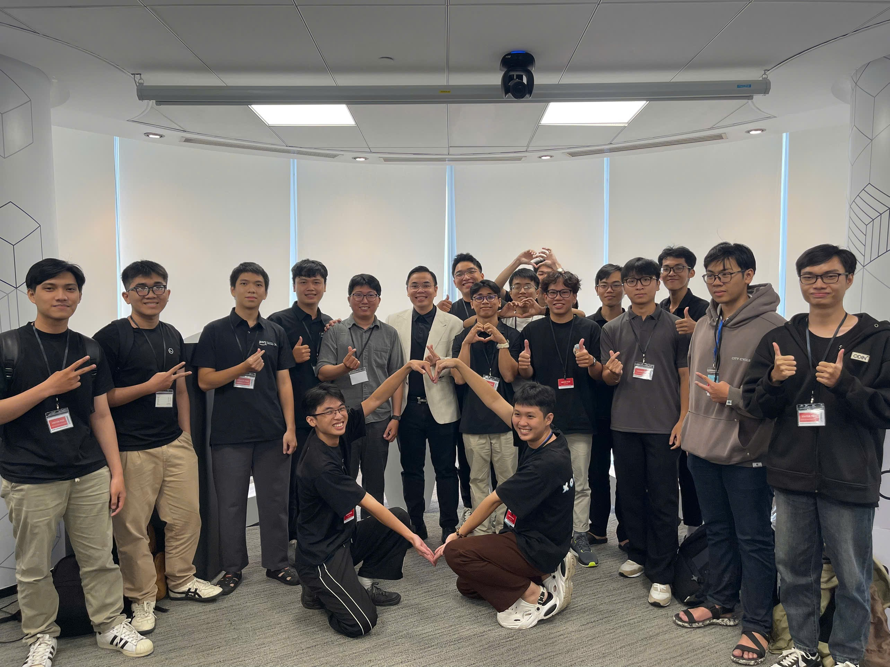

* **Thời gian:** 26/09/2026
* **Địa điểm:** Tầng 26, Bitexco Financial Tower, số 2 đường Hải Triều, phường Sài Gòn, Thành phố Hồ Chí Minh
* **Vai trò:** Người tham dự

## Nội dung chính tiếp thu

Sự kiện giới thiệu hành trình học AWS Cloud và tầm quan trọng của việc xây dựng nền tảng cloud trước khi đi sâu vào từng dịch vụ. Em theo dõi các nội dung về hệ sinh thái AWS, các nhóm dịch vụ cốt lõi và giá trị của việc học qua các bài thực hành có hướng dẫn.

## Giá trị nhận được

* Hiểu cách tổ chức lộ trình học từ kiến thức cloud cơ bản đến các lab thực hành.
* Củng cố vai trò của IAM, networking, compute, storage, database và monitoring.
* Học cách đón đầu vào thị trường việc làm sắp tới.

## Bài học rút ra

Sự kiện này đã giúp tôi hiểu rõ thực tế về các yêu cầu của thị trường việc làm hiện nay, những kiến thức nền tảng của công nghệ đám mây, và sự chuẩn bị cho tương lai sắp tới.

## Minh chứng tham gia

