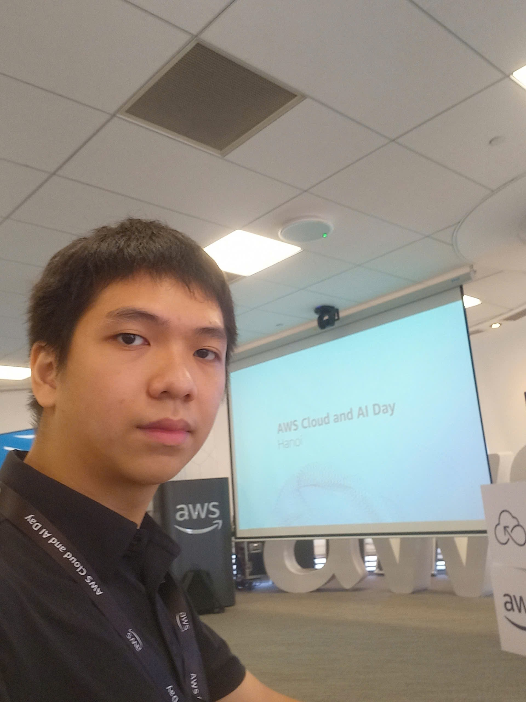

* **Date:** 29/09/2026
* **Location:** 26th Floor, Bitexco Financial Tower, 2 Hai Trieu Street, Sai Gon Ward, Ho Chi Minh City
* **Role:** Attendee

## Main Content

The watch party focused on current cloud and artificial-intelligence topics. I followed presentations and discussions about how cloud platforms support modern application development, data workloads, and practical AI adoption.

## Knowledge Gained

* Improved awareness of how cloud, data, and AI services can work together in an application.
* Learned that AI projects need suitable data, security controls, and an architecture that can scale.
* Observed how technical events can be used to learn from new trends and exchange ideas with other participants.

## Personal Reflection

The event broadened my view of AI beyond model development. It highlighted that successful AI solutions also depend on cloud infrastructure, data management, security, and a clear business purpose.

## Attendance Evidence

