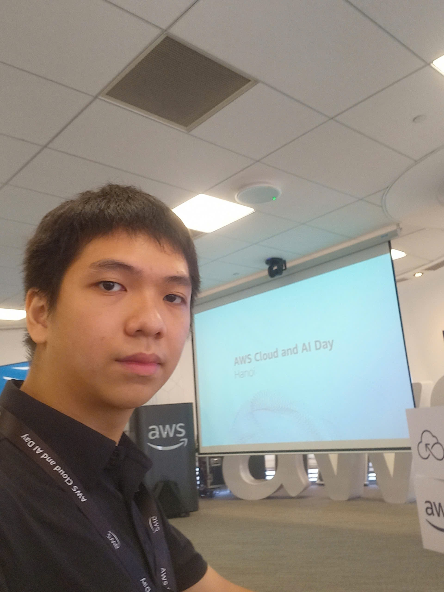

* **Thời gian:** 29/09/2026
* **Địa điểm:** Tầng 26, Bitexco Financial Tower, số 2 đường Hải Triều, phường Sài Gòn, Thành phố Hồ Chí Minh
* **Vai trò:** Người tham dự

## Nội dung chính tiếp thu

Watch Party tập trung vào các chủ đề cloud và trí tuệ nhân tạo hiện tại. Em theo dõi các bài trình bày, thảo luận về cách nền tảng cloud hỗ trợ phát triển ứng dụng hiện đại, khối lượng công việc dữ liệu và việc ứng dụng AI vào thực tế.

## Giá trị nhận được

* Hiểu rõ hơn cách các dịch vụ cloud, data và AI có thể kết hợp trong một ứng dụng.
* Nhận thấy dự án AI cần dữ liệu phù hợp, cơ chế bảo mật và kiến trúc có khả năng mở rộng.
* Quan sát cách sự kiện kỹ thuật giúp cập nhật xu hướng và trao đổi ý tưởng với các người tham dự khác.

## Bài học rút ra

Sự kiện giúp em mở rộng góc nhìn về AI vượt ngoài việc xây dựng mô hình. Một giải pháp AI thành công cũng cần hạ tầng cloud, quản lý dữ liệu, bảo mật và mục tiêu kinh doanh rõ ràng.

## Minh chứng tham gia

