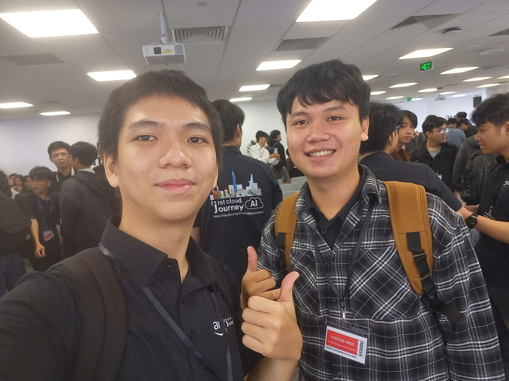

* **Date:** 02/09/2026
* **Location:** 26th Floor, Bitexco Financial Tower, 2 Hai Trieu Street, Sai Gon Ward, Ho Chi Minh City
* **Role:** Attendee

## Main Content

I attended the Fireside Chat with Dr. Werner and used the available event recording as a reference. The session provided an opportunity to hear industry perspectives and reflect on the technical mindset, curiosity, and continuous learning needed in cloud technology.

## Knowledge Gained

* Learned the importance of asking questions and building understanding from first principles.
* Recognized that cloud learning involves both technical skills and the ability to communicate, experiment, and adapt.
* Gained motivation to continue developing AWS knowledge through hands-on practice and community learning.

## Personal Reflection

The session reminded me that a strong technology career is built through long-term curiosity and consistent practice. I will apply this mindset by documenting what I learn, testing my ideas, and seeking feedback when I encounter problems.

## Attendance Evidence

