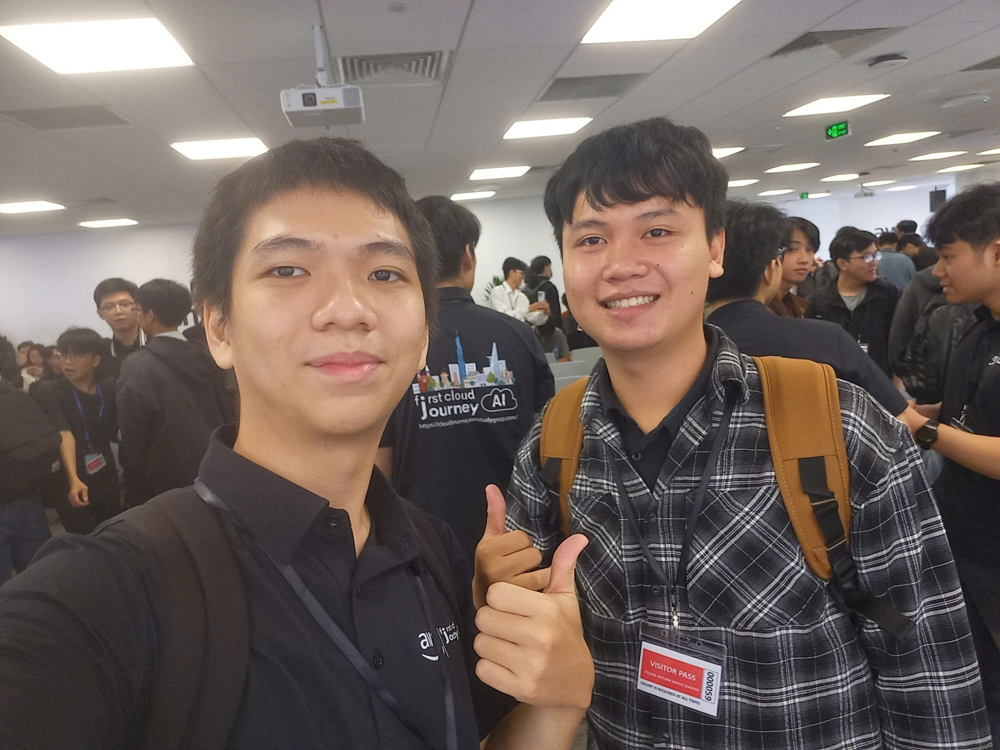

* **Thời gian:** 02/09/2026
* **Địa điểm:** Tầng 26, Bitexco Financial Tower, số 2 đường Hải Triều, phường Sài Gòn, Thành phố Hồ Chí Minh
* **Vai trò:** Người tham dự

## Nội dung chính tiếp thu

Em tham gia Fireside Chat with Dr. Werner và sử dụng bản ghi hình có sẵn làm tài liệu tham khảo. Buổi trò chuyện mang lại góc nhìn từ ngành, đồng thời gợi mở tư duy kỹ thuật, sự tò mò và tinh thần học tập liên tục trong lĩnh vực cloud.

## Giá trị nhận được

* Hiểu tầm quan trọng của việc đặt câu hỏi và xây dựng kiến thức từ các nguyên lý cơ bản.
* Nhận thấy học cloud cần kỹ năng kỹ thuật, khả năng giao tiếp, tinh thần thử nghiệm và thích nghi.
* Có thêm động lực tiếp tục phát triển kiến thức AWS thông qua thực hành và học hỏi từ cộng đồng.

## Bài học rút ra

Buổi trò chuyện nhắc em rằng một sự nghiệp công nghệ vững chắc được xây dựng từ sự tò mò lâu dài và việc thực hành đều đặn. Em sẽ áp dụng tư duy này bằng cách ghi chép điều đã học, thử nghiệm ý tưởng qua  và tìm phản hồi khi gặp vấn đề.

## Minh chứng tham gia

