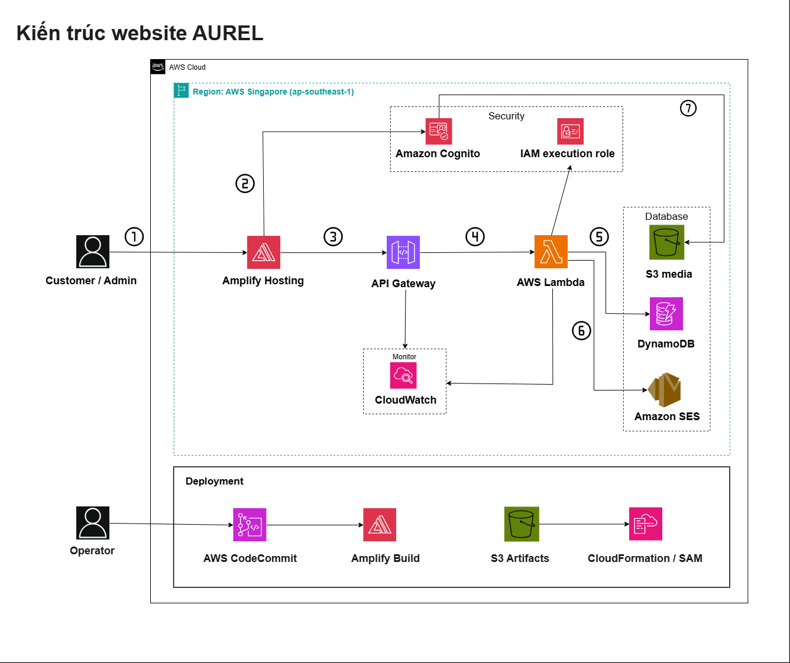

#### AUREL Architecture Diagram

Flow ③ is the path from Next.js BFF to API Gateway for administrative requests. The browser calls API Gateway directly for menu, reservations, and contact. Arrow ⑦ in the image connects Cognito to S3 Media. The actual flow is that Cognito issues an access token to the admin, Lambda writes images to S3 using its IAM execution role, and the browser then reads images via presigned GET URLs. S3 Media stores files, DynamoDB stores application data, and SES delivers emails.

CloudWatch centralizes logs and operational metrics. Section 5.9 details the access logs, dashboard, and four configured alarms.

#### Guest Flow

- The browser loads HTML, JavaScript, images, and fonts from Amplify Hosting over HTTPS.
- GET /menu calls API Gateway directly. Lambda queries the menu partition and returns currently available items.
- POST /reservations is validated against schema, consent, honeypot, IP/email rate limits, and Vietnam date-time.
- DynamoDB writes the request and increments the seat counter within the same transaction, limited to 24 seats per time slot. Resubmitting with an existing saved UUID will return the request ID without incrementing seats again.
- For new requests, Lambda attempts to send a receipt email via SES after the transaction succeeds. The restaurant confirms bookings separately. If sending fails, the request is still preserved. SES is currently in sandbox mode, so it can only send to verified addresses/domains or the mailbox simulator.
- POST /contact saves customer messages. Guest data cannot be read via public APIs.

#### Admin and Media Flow

The browser sends login credentials over HTTPS to Next.js BFF. BFF authenticates with Cognito and retains the access token in an HttpOnly cookie (Secure in production, SameSite=Strict). When calling admin APIs, BFF forwards the access token in the Authorization header. API Gateway's JWT authorizer verifies the signature using Cognito's JWKS public key, issuer, audience or client ID, and expiration. Lambda further verifies token_use=access and the admin group membership.

When an admin uploads dish images, the request passes through Next.js BFF and API Gateway. Lambda validates JPEG, PNG, or WebP files up to 2 MB, then stores them under the menu-images/ prefix in the private bucket. DynamoDB stores the image path alongside the dish record. When guests view the menu, Lambda verifies that the dish is currently active and the image version is current before issuing a presigned GET URL.

The experimental feature at /admin/media uses 120-second presigned PUT URLs and 900-second presigned GET URLs for direct browser-to-S3 transfers. Experimental files under uploads/ expire after 30 days. The Media bucket blocks public access and enforces HTTPS.

The Lambda execution role also possesses CRUD permissions on the application's DynamoDB table and send permissions via the configured SES identity.

#### DynamoDB Data Model

| pk | sk | Contents / Access |
|---|---|---|
| menu | Dish ID | MenuItem; public menu query filtered by available |
| reservations | UUID | Request details and status; read by admin only |
| contacts | UUID | Messages; read by admin only |
| slots | YYYY-MM-DD#HH:mm | Seats counter, conditionally updated |
| limits | Hash + time bucket | Hit count and expires TTL |

The table enables encryption and PITR on-demand. Adapter queries support pagination, but the dashboard currently fetches the full list; when scaling up, paginated APIs and date filtering are needed. TTL is a delayed cleanup mechanism, not a precision timer. The `pending` status still holds seats; physical tables and overlapping dining timeframes are not modeled.

#### Why Choose These Services?

| Service | Rationale | Trade-offs |
|---|---|---|
| Amplify Hosting | Managed HTTPS, CDN, Next SSR support, Git-based builds | Framework constraints and build/SSR/bandwidth costs |
| API Gateway HTTP API | JWT authorizer, CORS, throttling; simple operations | Cannot attach AWS WAF directly like REST API |
| Lambda | Auto-scales on demand; serverless | Cold starts, timeout, concurrency quota |
| DynamoDB | Transactions and conditional writes, on-demand | Must design around access patterns; no SQL joins |
| Cognito | Managed identities, admin groups, and tokens | MFA challenges require additional UI development |
| S3 | Private media, presigned URLs, lifecycle policies | Presigned URLs act as bearer capabilities until expiry |
| SES | Integrated AWS email, pay-per-use | Sandbox limits, deliverability, and retries need handling |
| CloudWatch | Centralized logs, metrics, dashboards, and alarms | Requires threshold tuning and alert routing plans |
| CodeCommit / CloudFormation | Private repository and reviewable infrastructure | Permissions and update workflows differ from GitHub App |

Lambda is not placed in a VPC merely to add diagram components: the application connects to public AWS service endpoints and has no database inside a private subnet. DynamoDB and S3 are regional managed services, not resources inside a private subnet. If private dependencies are added later, VPCs, endpoints, NAT, and costs should then be evaluated.

#### Deployment Flow

A git push to the CodeCommit main branch triggers Amplify to build and deploy the interface along with Next.js BFF. Backend and infrastructure are updated separately via AWS CLI using SAM/CloudFormation templates. The Artifacts bucket stores Lambda packages and deployment files. The Media bucket serves files uploaded by the application.

#### References

- [HTTP API and REST API](https://docs.aws.amazon.com/apigateway/latest/developerguide/http-api-vs-rest.html)
- [JWT Authorizer](https://docs.aws.amazon.com/apigateway/latest/developerguide/http-api-jwt-authorizer.html)
- [DynamoDB Transactions](https://docs.aws.amazon.com/amazondynamodb/latest/developerguide/transactions.html)
