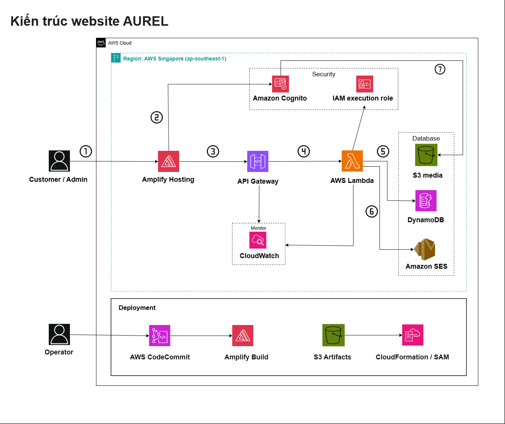

#### Sơ đồ kiến trúc AUREL

Luồng ③ là đường từ Next.js BFF tới API Gateway cho yêu cầu quản trị. Trình duyệt gọi trực tiếp API Gateway cho thực đơn, đặt bàn và liên hệ. Mũi tên ⑦ trên ảnh nối Cognito với S3 Media. Luồng thực tế là Cognito cấp access token cho admin, Lambda ghi ảnh vào S3 bằng IAM execution role, sau đó trình duyệt đọc ảnh qua URL GET ký sẵn. S3 Media lưu tệp, DynamoDB lưu dữ liệu ứng dụng và SES chuyển email.

CloudWatch tập trung log và số liệu vận hành. Mục 5.9 trình bày access log, dashboard và bốn cảnh báo đã cấu hình.

#### Luồng khách

- Trình duyệt tải HTML, JavaScript, ảnh và font từ Amplify Hosting qua HTTPS.
- GET /menu gọi trực tiếp API Gateway. Lambda query partition menu và trả món đang phục vụ.
- POST /reservations được kiểm tra schema, consent, honeypot, giới hạn IP/email và ngày giờ theo Việt Nam.
- DynamoDB ghi yêu cầu và tăng bộ đếm ghế trong cùng một transaction, giới hạn 24 ghế mỗi khung giờ. Gửi lại cùng UUID đã lưu sẽ nhận lại mã yêu cầu, không tăng ghế lần nữa.
- Với yêu cầu mới, Lambda thử gửi email tiếp nhận qua SES sau khi transaction thành công. Nhà hàng xác nhận đặt bàn riêng. Nếu gửi lỗi, yêu cầu vẫn được lưu. SES đang ở sandbox nên chỉ gửi được tới địa chỉ hoặc tên miền đã xác minh, hoặc mailbox simulator.
- POST /contact lưu lời nhắn. Dữ liệu khách không được đọc qua public API.

#### Luồng admin và media

Trình duyệt gửi thông tin đăng nhập qua HTTPS đến Next.js BFF. BFF xác thực với Cognito và giữ access token trong cookie HttpOnly, Secure trên môi trường triển khai, SameSite=Strict. Khi gọi API admin, BFF chuyển access token trong header Authorization. JWT authorizer của API Gateway kiểm tra chữ ký bằng khóa công khai JWKS của Cognito, issuer, audience hoặc client ID và thời hạn. Lambda kiểm tra tiếp token_use=access và nhóm admin.

Khi admin tải ảnh món ăn, yêu cầu đi qua Next.js BFF và API Gateway. Lambda kiểm tra tệp JPEG, PNG hoặc WebP tối đa 2 MB rồi lưu vào tiền tố menu-images/ của bucket riêng tư. DynamoDB lưu đường dẫn ảnh cùng bản ghi món. Khi khách xem thực đơn, Lambda kiểm tra món đang hiển thị và phiên bản ảnh hiện hành trước khi cấp URL GET ký sẵn.

Chức năng thử nghiệm tại /admin/media dùng URL PUT ký sẵn 120 giây và URL GET ký sẵn 900 giây để trình duyệt truyền tệp trực tiếp với S3. Tệp thử nghiệm trong uploads/ hết hạn sau 30 ngày. Bucket Media chặn truy cập công khai và yêu cầu HTTPS.

Role của Lambda còn có quyền CRUD trên bảng DynamoDB của ứng dụng và quyền gửi qua danh tính SES đã cấu hình.

#### Mô hình DynamoDB

| pk | sk | Nội dung / Truy cập |
|---|---|---|
| menu | ID món | MenuItem; query menu công khai có lọc available |
| reservations | UUID | Thông tin yêu cầu và trạng thái; chỉ admin đọc |
| contacts | UUID | Lời nhắn; chỉ admin đọc |
| slots | YYYY-MM-DD#HH:mm | Bộ đếm seats, cập nhật có điều kiện |
| limits | Mã băm + time bucket | Số lượt và TTL expires |

Bảng bật mã hóa và PITR, on-demand. Query danh sách có pagination ở adapter nhưng dashboard hiện tải hết danh sách; khi tăng quy mô cần API phân trang và lọc theo ngày. TTL là cơ chế dọn dẹp trễ, không dùng làm bộ hẹn giờ chính xác. Trạng thái pending vẫn giữ chỗ; không mô hình hóa bàn và thời gian giao nhau.

#### Vì sao chọn các dịch vụ này?

| Dịch vụ | Căn cứ chọn | Đánh đổi |
|---|---|---|
| Amplify Hosting | HTTPS, CDN do dịch vụ quản lý, hỗ trợ Next SSR, build từ Git | Giới hạn framework và chi phí build/SSR/băng thông |
| API Gateway HTTP API | JWT authorizer, CORS, throttling; vận hành đơn giản | Không gắn AWS WAF trực tiếp như REST API |
| Lambda | Tự mở rộng theo yêu cầu; không quản lý máy chủ | Cold start, timeout, quota concurrency |
| DynamoDB | Transaction và conditional writes, on-demand | Phải thiết kế theo access pattern; không join SQL |
| Cognito | Danh tính/admin group/token được quản lý | MFA challenge cần phát triển thêm trong UI |
| S3 | Media riêng tư, URL ký, lifecycle | URL ký là bearer capability đến khi hết hạn |
| SES | Email tích hợp AWS, tính phí theo dùng | Sandbox, deliverability và retry cần xử lý |
| CloudWatch | Log, metric, dashboard, alarm | Cần ngưỡng phù hợp và kế hoạch thông báo |
| CodeCommit / CloudFormation | Source riêng tư và triển khai có thể rà soát | Cần quyền và quy trình cập nhật, khác GitHub App |

Không gắn Lambda vào VPC chỉ để làm sơ đồ nhiều thành phần: ứng dụng dùng endpoint dịch vụ AWS và không có database trong subnet riêng. DynamoDB/S3 là regional managed services, không đặt chúng trong private subnet. Nếu thêm private dependency thì mới đánh giá VPC, endpoint, NAT và chi phí.

#### Luồng triển khai

Git push lên nhánh main của CodeCommit kích hoạt Amplify build và triển khai giao diện cùng Next.js BFF. Backend và hạ tầng được cập nhật riêng bằng AWS CLI với template SAM/CloudFormation. Bucket Artifacts chứa gói Lambda và tệp triển khai. Bucket Media phục vụ tệp tải lên từ ứng dụng.

#### Tài liệu tham khảo

- [HTTP API và REST API](https://docs.aws.amazon.com/apigateway/latest/developerguide/http-api-vs-rest.html)
- [JWT authorizer](https://docs.aws.amazon.com/apigateway/latest/developerguide/http-api-jwt-authorizer.html)
- [DynamoDB transactions](https://docs.aws.amazon.com/amazondynamodb/latest/developerguide/transactions.html)
