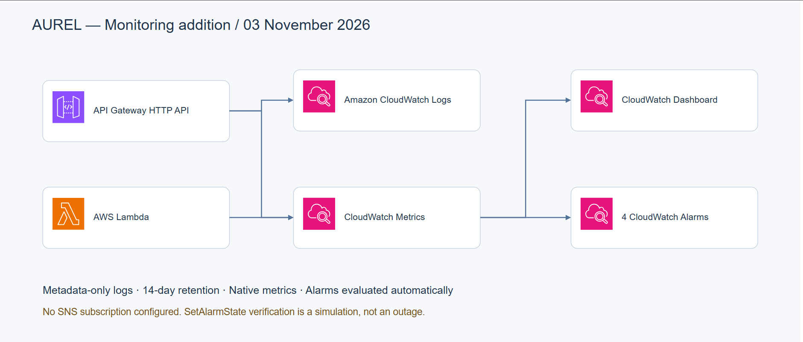
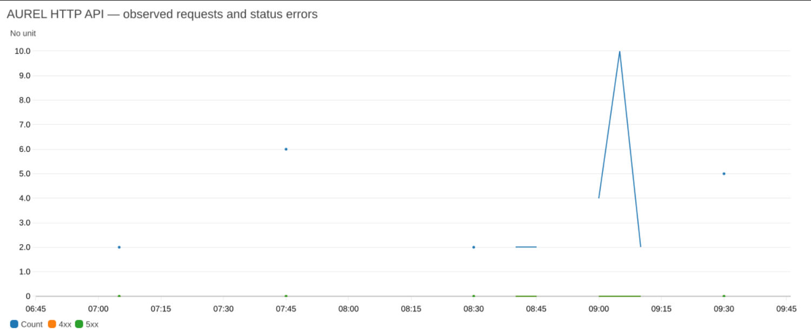

#### Supplementary Operational Configuration

The aurel-observability stack provisioned a dashboard, four alarms, and a dedicated log group. API stage access logging is configured via CLI outside the original backend SAM template and should be reapplied after any stage changes.




#### Reproducing the Configuration

Download the two files into the same directory. API_ID is the API identifier from ApiUrl; obtain FUNCTION_NAME from your lab's Lambda/CloudFormation outputs.

```bash
aws cloudformation deploy --stack-name aurel-observability \
  --template-file observability.json \
  --parameter-overrides ApiId=YOUR_API_ID FunctionName=YOUR_FUNCTION_NAME
python3 configure-api-logs.py --api-id YOUR_API_ID
aws cloudwatch describe-alarms --alarm-name-prefix aurel-observability-
aws logs tail /aurel/aurel-observability/http-api --since 10m
aws logs tail /aws/lambda/aurel-backend-api --since 10m
```

Logs contain only requestId, requestTime, routeKey, status, responseLength, and integrationLatency, with a 14-day retention period. Cookies, Authorization headers, and request bodies are omitted. Lambda maintains its separate log group. requestTime retains the original timestamp provided by API Gateway; correlate it with event timestamps in CloudWatch.

#### Metrics and Alarms

| Alarm | Metric / Statistic | Condition | Remediation |
|---|---|---|---|
| LambdaErrors | AWS/Lambda Errors, Sum | >=1 in 5 minutes | Inspect timeouts/runtime failures and Lambda logs |
| LambdaThrottles | Throttles, Sum | >=1 in 5 minutes | Review concurrency/quotas and reduce burst limits |
| Api5xx | AWS/ApiGateway 5xx, Sum | >=1 in 5 minutes | Correlate requestId across API and Lambda logs |
| ApiLatency | Latency, Average | >=2000 ms across 2 consecutive 5-minute windows | Check cold starts, DynamoDB, SES, and traffic load |

Missing data is treated as notBreaching; do not rely on this setting as proof that the system is always healthy. An idle system without traffic may still show an OK status. The Average latency alarm is not an indicator of p95 performance. A handler returning JSON 500 may not increment Lambda Errors; the API 5xx metric adds visibility into caught runtime failures.



The chart above was retrieved using GetMetricWidgetImage from CloudWatch, not a manual Console screenshot. 4xx errors during testing include unauthenticated requests and invalid bodies generated intentionally during negative testing; they do not reflect actual customer incidents.

#### Evidence and Alert Limitations

The file [monitoring.json](monitoring.json) documents stack status, thresholds, log configuration, and state transition history. The SetAlarmState test transitioned Api5xx to ALARM and back to OK to verify the state management pipeline. This was a simulation; actual threshold breaches and external notification deliveries under real 5xx conditions have not been verified.

Currently, AlarmActions and OKActions are empty with no active SNS subscriptions. Therefore, alarms evaluate within CloudWatch but do not dispatch emails. To deliver alerts outside the Console, an SNS topic and subscriptions must be created, verified via AWS confirmation email, and tested end-to-end; simply creating alarms does not constitute a complete email alert mechanism.

#### Runbook

1. Identify the alarm, time window, and traffic volume; distinguish 4xx user input errors from 5xx system failures.
2. Search for the requestId in access logs and correlate timestamps with Lambda logs, Duration, and Throttles.
3. If a new deployment introduced errors, compare commits/jobs and promote a stable commit through the pipeline; never wipe the database as a troubleshooting measure.
4. If SES fails, verify sandbox status, identity verification, and quotas; reservation requests are preserved in admin, so avoid creating duplicate UUIDs merely to re-trigger emails.
5. Following remediation, verify with both valid and invalid requests, review metrics and alarm recovery status, and document root causes and preventative actions.

#### References

- [HTTP API Metrics](https://docs.aws.amazon.com/apigateway/latest/developerguide/http-api-metrics.html)
- [HTTP API Access Logs](https://docs.aws.amazon.com/apigateway/latest/developerguide/http-api-logging.html)
- [SetAlarmState](https://docs.aws.amazon.com/AmazonCloudWatch/latest/APIReference/API_SetAlarmState.html)

Live logs were verified via GetLogEvents: GET /menu returned 200, admin routes without tokens returned 401, and two malformed reservation payloads returned 400. Sanitized log samples omit IDs and customer details. FilterLogEvents may experience indexing latency even when streams contain data; use GetLogEvents for authoritative verification.
