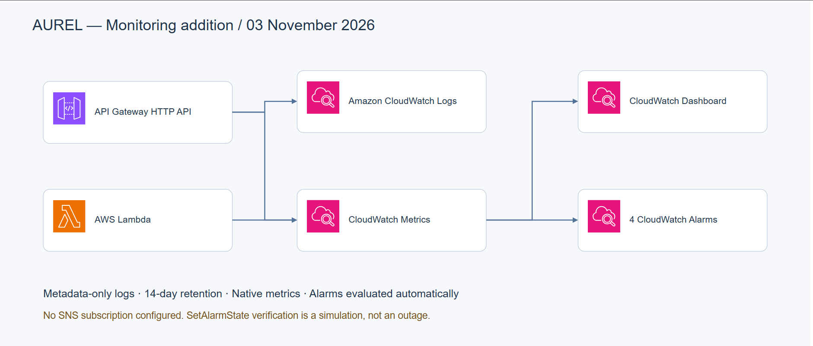
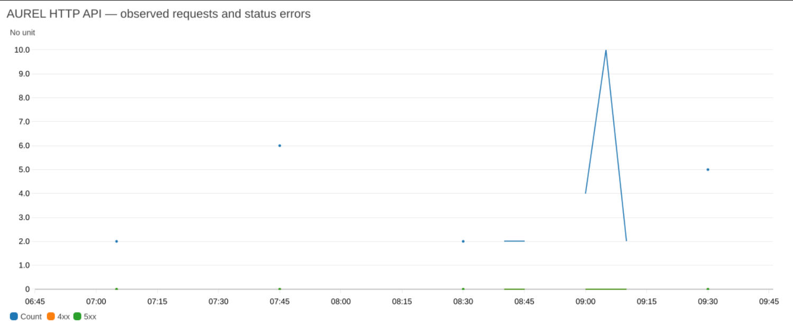

#### Cấu hình thực tế bổ sung 

Stack aurel-observability đã tạo dashboard, bốn alarm và log group riêng. API stage được cấu hình access log bằng CLI; cấu hình này nằm ngoài backend SAM template gốc, nên phải áp dụng lại sau thay đổi stage. 




#### Tái lập cấu hình

Tải hai tệp ở trên vào cùng thư mục. API_ID là đoạn tên API trong ApiUrl, FUNCTION_NAME lấy từ Lambda/CloudFormation của lab.

```bash
aws cloudformation deploy --stack-name aurel-observability \
  --template-file observability.json \
  --parameter-overrides ApiId=YOUR_API_ID FunctionName=YOUR_FUNCTION_NAME
python3 configure-api-logs.py --api-id YOUR_API_ID
aws cloudwatch describe-alarms --alarm-name-prefix aurel-observability-
aws logs tail /aurel/aurel-observability/http-api --since 10m
aws logs tail /aws/lambda/aurel-backend-api --since 10m
```

Log chỉ chứa requestId, requestTime, routeKey, status, responseLength và integrationLatency; retention 14 ngày. Không ghi Cookie, Authorization hay body. Lambda log vẫn dùng log group riêng. requestTime giữ nguyên giá trị thời gian do API Gateway cung cấp; đối chiếu cùng thời gian sự kiện trong CloudWatch.

#### Metrics và alarm

| Alarm | Metric / Statistic | Điều kiện | Cách xử lý |
|---|---|---|---|
| LambdaErrors | AWS/Lambda Errors, Sum | >=1 trong 5 phút | Xem timeout/runtime failure và Lambda log |
| LambdaThrottles | Throttles, Sum | >=1 trong 5 phút | Đối chiếu concurrency/quota, giảm burst |
| Api5xx | AWS/ApiGateway 5xx, Sum | >=1 trong 5 phút | Đối chiếu requestId với API và Lambda logs |
| ApiLatency | Latency, Average | >=2000 ms trong 2 cửa sổ 5 phút liên tiếp | Kiểm tra cold start, DDB, SES và tải |

Missing data được coi là notBreaching; không dùng cài đặt này để chứng minh hệ thống luôn sẵn sàng. Một hệ thống không nhận traffic vẫn có thể hiện OK. Alarm Average không phải mục tiêu p95. Handler trả JSON 500 có thể không tăng Lambda Errors; API 5xx bổ sung khả năng quan sát lỗi đã được handler bắt.



Biểu đồ trên được lấy bằng GetMetricWidgetImage từ CloudWatch, không phải ảnh chụp Console. 4xx trong bài thử bao gồm yêu cầu không token/body sai do kiểm thử chủ động; không diễn giải thành sự cố khách hàng.

#### Bằng chứng và giới hạn cảnh báo

Tệp [monitoring.json](monitoring.json) ghi stack status, ngưỡng, cấu hình log và lịch sử chuyển trạng thái. Bài thử SetAlarmState chuyển Api5xx sang ALARM rồi OK để xác nhận đường quản lý trạng thái. Đây là mô phỏng; chưa kiểm tra threshold bằng sự cố 5xx thật và chưa có bằng chứng giao thông báo.

Hiện AlarmActions/OKActions trống, không có SNS subscription. Vì vậy alarm tự đánh giá trên CloudWatch nhưng chưa gửi email. Muốn cảnh báo ngoài Console, cần thêm topic/subscription sau khi chủ email đồng ý, xác nhận thư AWS và kiểm tra đường giao thư; không coi chỉ tạo alarm là hoàn thành email alert.

#### Runbook

1. Xác định alarm, cửa sổ thời gian và lưu lượng; phân biệt 4xx nhập sai với 5xx hệ thống.
2. Tìm requestId trong access log, so thời gian với Lambda log và Duration/Throttles.
3. Nếu deploy mới gây lỗi, đối chiếu commit/job và đưa commit ổn định qua pipeline; không xóa database để thử lại.
4. Nếu SES lỗi, kiểm tra sandbox, identity, quota; yêu cầu vẫn nằm trong admin, tránh tạo UUID mới chỉ để gửi thư lại.
5. Sau khắc phục, kiểm tra lại request hợp lệ/không hợp lệ, metric và trạng thái alarm; ghi nguyên nhân và hành động phòng ngừa.

#### Liên kết tham khảo

- [HTTP API metrics](https://docs.aws.amazon.com/apigateway/latest/developerguide/http-api-metrics.html)
- [HTTP API access logs](https://docs.aws.amazon.com/apigateway/latest/developerguide/http-api-logging.html)
- [SetAlarmState](https://docs.aws.amazon.com/AmazonCloudWatch/latest/APIReference/API_SetAlarmState.html)

Đã đọc bản ghi thực tế bằng GetLogEvents: GET /menu trả 200, route admin không token trả 401, hai body đặt bàn sai trả 400. Evidence ghi mẫu đã lược bỏ ID, không kèm nội dung khách. FilterLogEvents có thể chưa phản ánh ngay dù stream đã có dữ liệu; dùng GetLogEvents để đối chiếu.
